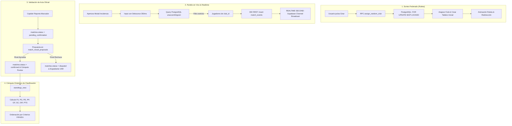

# FLUJO DE DATOS DEL SISTEMA — EA FC COMPANION V2

---

## 1. Asignación Atómica de Clubes (Ruleta)
1. El cliente móvil invoca el RPC `assign_random_club(p_tournament_id)`.
2. PostgreSQL abre una transacción atómica verificando si el usuario ya cuenta con club en dicho torneo:
   - Si ya cuenta con club, devuelve el existente sin reasignación.
   - Si no cuenta con club, busca un club activo con `FOR UPDATE SKIP LOCKED` donde `club_id NOT IN (SELECT club_id FROM tournament_participants WHERE tournament_id = p_tournament_id)`.
3. Se actualiza `tournament_participants` con `club_id` y timestamp de asignación.
4. Se inicializa el tablero táctico con formación `4-3-3 Ofensiva`.

---

## 2. Minuto a Minuto con DB-First y Realtime-Second
1. El usuario abre el modal para registrar gol o tarjeta.
2. A medida que escribe, un hook con `setTimeout` de 350ms emite la consulta.
3. Se ejecuta `playersService.searchPlayersByClub(clubId, debouncedQuery)`.
4. El backend filtra estrictamente por `club_id = target_club_id` con `ILIKE %normalized_name%`.
5. Al pulsar sobre el jugador:
   - **DB FIRST**: Se inserta el evento en la tabla `match_events`.
   - **REALTIME SECOND**: La inserción dispara la notificación de réplica de PostgreSQL al canal WebSocket suscrito en ambos dispositivos.

---

## 3. Protocolo de Apretón de Manos (Validation Handshake)
1. Al pulsar "Finalizar y Reportar", se ejecuta `submit_match_result()`.
2. Se crea una propuesta con estado `pending` y el partido pasa a `pending_confirmation`.
3. El contrincante visualiza la pantalla de validación:
   - Si pulsa **Aprobar**: `respond_to_match_result(proposalId, true)` actualiza el partido a `confirmed` y graba los marcadores finales.
   - Si pulsa **Rechazar**: `respond_to_match_result(proposalId, false)` actualiza el partido a `disputed` y crea automáticamente un expediente en `match_disputes`.

---

## 4. Normalización de Coordenadas Tácticas
Para que la pizarra táctica sea fiel tanto en dispositivos compactos como en pantallas de alta densidad:
$$\text{Coordenada Guardada} = \frac{\text{Posición Pantalla } (X, Y)}{\text{Dimensiones Cancha Pantalla}} \in [0.000, 1.000]$$
$$\text{Posición Renderizada} = X_{\text{norm}} \times \text{Ancho Actual de Cancha}$$
Esto garantiza invariancia absoluta de disposición táctica independientemente de la resolución o ratio de aspecto del móvil.
